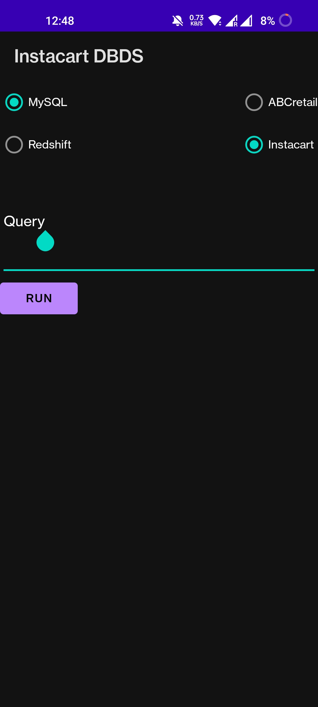

# Instacart DBDS

**Query MySQL and Amazon Redshift from your phone and compare how fast each one answers.**

Instacart DBDS is an Android app that sends SQL queries to a remote backend. You choose the database engine (MySQL or Amazon Redshift) and the dataset (Instacart or ABC Retail). The app shows the results as a table, along with how long the query took, so you can compare the two engines on the same data.

<p align="center">
  
</p>

---

## Features

- **Choose the engine:** run the same query on **MySQL** (row-oriented, OLTP) or **Amazon Redshift** (columnar, OLAP).
- **Choose the dataset:** query the **Instacart** or **ABC Retail** dataset.
- **Write any SQL:** type a query and tap **Run**.
- **See the results as a table:** rows come back from the server and display in a scrollable table.
- **Timing:** the app shows the time from sending the request to getting the response, in milliseconds.
- **Error messages:** SQL or server errors are shown in the app.

## How it works

```
┌──────────────────┐   POST /send_query (JSON)    ┌────────────────────┐      ┌──────────────┐
│  Android app     │ ───────────────────────────▶ │  Backend API       │ ───▶ │ MySQL        │
│  (this repo)     │                              │  (AWS EC2 :5000)   │      ├──────────────┤
│                  │ ◀─────────────────────────── │                    │ ───▶ │ Redshift     │
└──────────────────┘   JSON array of rows         └────────────────────┘      └──────────────┘
```

1. The app builds a JSON request from what you selected and typed.
2. It sends the request to the backend's `/send_query` endpoint using OkHttp.
3. The backend runs the query on the chosen engine and dataset, then returns the rows.
4. The app draws a `TableLayout` with the rows and shows the elapsed time.

### API contract

**Request:** `POST /send_query`, `Content-Type: application/json`

```json
{
  "database": "MySQL",
  "database_name": "Instacart",
  "query": "SELECT department, COUNT(*) FROM products GROUP BY department LIMIT 10;"
}
```

| Field           | Values                   | Description                |
|-----------------|--------------------------|----------------------------|
| `database`      | `MySQL` \| `Redshift`    | The engine that runs the query |
| `database_name` | `Instacart` \| `ABCretail` | The dataset or schema to query |
| `query`         | any SQL string           | The query to run           |

**Success response (`2xx`):** a JSON array of rows, where each row is an array of values:

```json
[
  ["produce", 1684],
  ["snacks", 1258]
]
```

**Error response (non-`2xx`):** a plain-text or JSON error message. The app displays it as is.

> **Note:** this repository contains only the Android client. The backend service is not included. Any server that follows the contract above will work.

## Tech stack

| Layer    | Technology                                              |
|----------|---------------------------------------------------------|
| Client   | Android (Java), AppCompat, Material Components, ConstraintLayout |
| HTTP     | OkHttp 3.10                                             |
| Backend  | REST API on AWS EC2, port 5000 (not in this repo)       |
| Databases| MySQL, Amazon Redshift                                  |
| Build    | Gradle; `compileSdk 32`, `minSdk 21` (Android 5.0+)     |

## Getting started

### Prerequisites
- Android Studio (Bumblebee or newer recommended)
- JDK 11
- An Android device or emulator running API 21 or higher
- A running backend that follows the API contract above

> The app allows cleartext HTTP (`android:usesCleartextTraffic="true"`) so it can reach a plain-HTTP backend. Use HTTPS in production.

## Usage

1. Choose an engine: **MySQL** or **Redshift**.
2. Choose a dataset: **Instacart** or **ABCretail**.
3. Type a SQL query in the **Query** field.
4. Tap **Run**.
5. Read the results table and the time shown in **ms**.

Run the same query on both engines to see how a row store and a column store differ on analytical workloads. Large aggregations over the Instacart orders data are a good place to start.

### Example queries (Instacart schema)

```sql
-- Top 10 most-ordered products
SELECT p.product_name, COUNT(*) AS orders
FROM order_products op
JOIN products p ON p.product_id = op.product_id
GROUP BY p.product_name
ORDER BY orders DESC
LIMIT 10;

-- Orders by hour of day
SELECT order_hour_of_day, COUNT(*) AS orders
FROM orders
GROUP BY order_hour_of_day
ORDER BY order_hour_of_day;
```

*Table names depend on how your backend loaded the data. Change them to match your schema.*

## Project structure

```
InstacartDBDS/
├── app/
│   ├── build.gradle
│   └── src/main/
│       ├── AndroidManifest.xml
│       ├── java/com/example/instacartdbds/
│       │   └── MainActivity.java      # UI logic, HTTP request, results table
│       └── res/layout/
│           └── activity_main.xml      # Engine and dataset pickers, query box, results area
├── build.gradle
├── settings.gradle
└── README.md
```

## Limitations and ideas for improvement

- **Elapsed time is measured on the phone.** It covers the full round trip, including network latency, not only query execution. Having the server return its own execution time would make the comparison more accurate.
- **The backend URL is hardcoded.** It could be moved to `BuildConfig` or a settings screen.
- **There is no header row.** Column names are not displayed yet. The backend could return them along with the rows.
- **Large result sets** are drawn all at once. Paging or a `RecyclerView` would handle big outputs better.
- **The `onFailure` callback** updates the UI off the main thread. It should be wrapped in `runOnUiThread`.
- **Security:** the backend runs arbitrary SQL, so it should use a read-only database user and authentication.

## Datasets

- **Instacart:** the public *Instacart Market Basket Analysis* dataset of about 3 million grocery orders from more than 200,000 users.
- **ABC Retail:** a sample retail transactions dataset.

## Contributing

Issues and pull requests are welcome. For large changes, please open an issue first to discuss them.